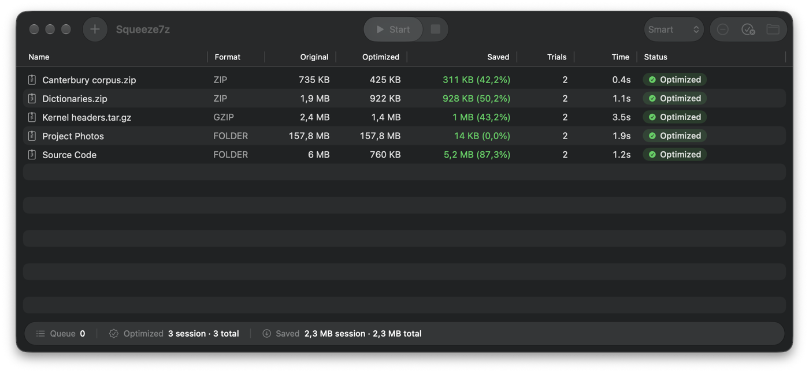
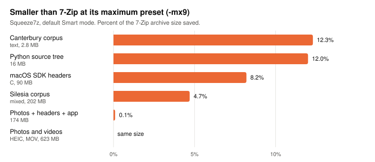
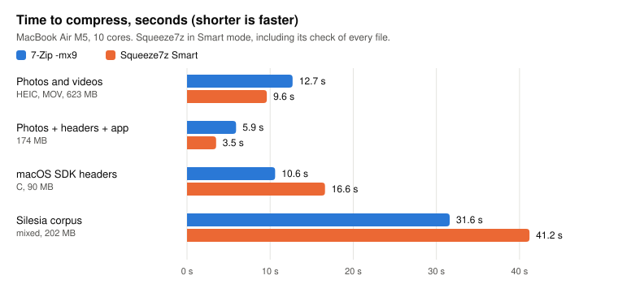

<p align="center"></p>

<h1 align="center">Squeeze7z</h1>

<p align="center">Smaller 7z archives on the Mac, checked file by file before anything is kept.</p>

<p align="center"></p>

Squeeze7z packs folders into 7z files, and repacks existing archives (zip, rar, tar.gz, 7z, iso and others) into smaller 7z files. It looks at what is inside and picks the 7-Zip method that suits each kind of data: PPMd for text and source code, LZMA2 for everything else. Then it extracts the result in a test run and compares every file with the original. The new archive is kept only if it is smaller.

The output is a normal 7z file. It opens with 7-Zip, Keka and the Archive Utility built into macOS.

## Download

Get `Squeeze7z.zip` from the [latest release](https://github.com/Camponotus-vagus/Squeeze7z/releases/latest), unzip it and move `Squeeze7z.app` to Applications.

It needs macOS 26 or later on Apple Silicon.

The app is not notarized by Apple, so the first launch is blocked. Open it once, then go to System Settings → Privacy & Security and click "Open Anyway" next to the Squeeze7z message. If you prefer the terminal:

```bash
xattr -dr com.apple.quarantine /Applications/Squeeze7z.app
```

### Updates

From version 0.2.0 the app updates itself. It checks GitHub for new versions (on the second launch it asks whether to do that automatically), shows what changed, and installs the update and relaunches when you agree. Use Squeeze7z → Check for Updates… to check by hand, and Settings → General to turn the automatic check on or off. Updates are signed: the app installs only archives signed with the project's key. Versions 0.1.x have no updater, so moving to 0.2.0 is a manual download, once.

## Using it

1. Drag folders or archives onto the window (or onto the Dock icon), or use the + button.
2. Click Start.
3. A folder becomes `Folder.7z` next to it. An archive becomes `name_optimized.7z` next to it, unless you choose in Settings to replace the original, which then goes to the Trash.

While a job runs, its row shows the step it is on (extracting, compressing, verifying) with a percentage, the files done out of the total, the file being worked on and the time left for that step. While it compresses, the Saved column shows an estimate in grey (≈) of what it is saving; the exact figure replaces it once the archive is verified.

Double-click a finished row to see what was done: which method each group of files got, how long it took, and the log.

## Is it better than 7-Zip or Keka?

A little, and how much depends on what you compress. The comparison below is against `7zz a -mx9`, the strongest preset of 7-Zip. Keka at its maximum setting uses the same 7-Zip engine and lands within a few bytes of it.

<picture>
  <source media="(prefers-color-scheme: dark)" srcset="docs/images/size-dark.svg">
  
</picture>

- Text and source code: about 5 to 12% smaller. 7-Zip stores text with LZMA2. PPMd, which 7-Zip also contains but never picks by itself, does better on text.
- Photos, videos, music, zips inside the folder: the same size. That data is already compressed, and no 7z setting gets more out of it. Neither does Squeeze7z.

<picture>
  <source media="(prefers-color-scheme: dark)" srcset="docs/images/time-dark.svg">
  
</picture>

- Faster on photos and videos: 7-Zip at `-mx9` compresses a few hundred MB as one stream, which keeps two cores busy. Squeeze7z splits already compressed files into chunks that every core works on, for an archive a few KB larger at most. A quick test on a sample comes first: when the files still compress (thousands of small JPEGs with near-identical headers, for example), it uses as many chunks as `-mx9` would, of equal size, so the archive stays smaller than with `-mx9` and the compression takes no longer.
- Slower on text: 1.3 to 1.6 times the time of 7-Zip on inputs of tens of MB or more. That is the price of the PPMd block, which runs on one core, plus the check of every file at the end.

The numbers, the inputs and the method are in [BENCHMARKS.md](BENCHMARKS.md).

The other reason to use it is clean-up. Drop a hundred old zip, rar and tar.gz files on the window and let it run. Each one is converted, verified and kept only if smaller. Zip files made with the Finder usually shrink by a third or more.

## Modes

Smart is the default and the right choice almost always.

| Mode | What it does |
|---|---|
| Fast | One LZMA2 archive, like 7-Zip at `-mx9`, with photos and videos on all cores. |
| Smart | Fast, plus a version with text in PPMd. The smaller one wins. |
| Normal to Extreme 2 | Tries several methods on each group of files (Delta for raw audio and images, BCJ2 for x86 programs, more PPMd and LZMA settings). Best gained about 0.1% over Smart in the benchmark, for four times the time. Use it only for archives you keep for years. |

## What to know before you use it

- Keep a backup of important archives. The check guards the output, but it does not replace a backup.
- The original is never changed. With "Replace original" turned on it goes to the Trash, never deleted.
- Encrypted archives are skipped. Squeeze7z never asks for a password.
- You need free disk space of a few times the unpacked size while it works.
- Text stored with PPMd needs about 260 MB of memory to extract, whatever the archive size.
- Programs for Apple Silicon get the ARM64 filter, as with 7-Zip. 7-Zip older than version 23 (2023) and p7zip cannot open those archives; turn off "Use ARM64/RISC-V filters" in Settings if that matters to you.
- Zip files made by the Finder often hold a `__MACOSX` folder of metadata. It is left out, because the Archive Utility of macOS would expand it over the real files of a 7z. Settings has an option to keep it.
- Extended attributes, Finder tags and the group-write permission bits are not carried over. 7z cannot store the first two.

## Command line

The same engine is available as `squeeze7z-cli`:

```bash
squeeze7z-cli optimize "My Folder"                 # writes "My Folder.7z" next to it
squeeze7z-cli optimize --out ~/Desktop old.zip     # writes ~/Desktop/old_optimized.7z
squeeze7z-cli optimize --replace backup.rar        # new 7z in place, original to the Trash
squeeze7z-cli optimize --mode best archive.tgz     # slower, tries harder
squeeze7z-cli inspect archive.7z                   # listing and file groups
```

`squeeze7z-cli --help` lists every option.

## Building from source

Requirements: Xcode 27 or a Swift 6.4 toolchain, macOS 26, Apple Silicon.

```bash
git clone https://github.com/Camponotus-vagus/Squeeze7z.git
cd Squeeze7z
swift test                       # run the tests
scripts/build-app.sh --install   # build/Squeeze7z.app, copied to ~/Applications
scripts/build-cli.sh             # build/squeeze7z-cli
```

`scripts/release.sh VERSION NOTES.md` publishes a release: it builds the app from a fresh clone, signs the zip with the EdDSA key in the login Keychain, creates the GitHub release and then adds it to `appcast.xml`, the feed the app reads. Updates use [Sparkle](https://sparkle-project.org).

The app is written in Swift 6 and SwiftUI. All compression is done by the official 7-Zip console program `7zz` (version 26.06, with the RAR codecs), which ships in `Vendor/7zip` and is copied into the app bundle. Homebrew's `7zz` works as a fallback, but it cannot read RAR files.

How a job runs:

1. List the archive with `7zz l -slt` and refuse encrypted ones.
2. Extract it to a private temporary folder (a folder is cloned there instead, which on APFS takes no extra space).
3. Group the files by extension and by kind: text, executables, raw images, raw audio, already compressed, other.
4. Build the candidate archives for the chosen mode and keep the smallest.
5. Run `7zz t` on it and compare the path, size and CRC32 of every file with the extracted tree.
6. Write it only if it passed and is smaller than the original.

## Credits

Squeeze7z takes its idea from Ultra7z Archive Optimizer by supercompression.org, a Windows program. No code, name or artwork comes from it, and this project is not affiliated with it.

The compression engine is 7-Zip by Igor Pavlov, included unchanged. Updates are handled by Sparkle (MIT license), also included unchanged.

## License

Squeeze7z is released under the [MIT License](LICENSE).

The bundled `7zz` is distributed under the GNU LGPL with the unRAR restriction: its RAR code may be used to extract RAR archives, but not to recreate the RAR compression algorithm. Squeeze7z only reads RAR archives and never writes them. The full text is in [Vendor/7zip/License.txt](Vendor/7zip/License.txt) and inside the app bundle.
